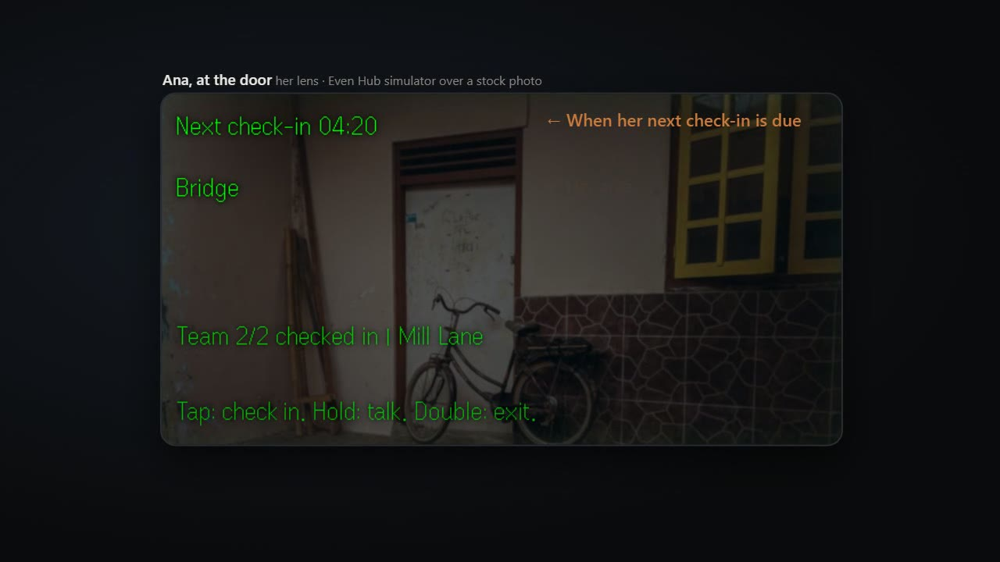
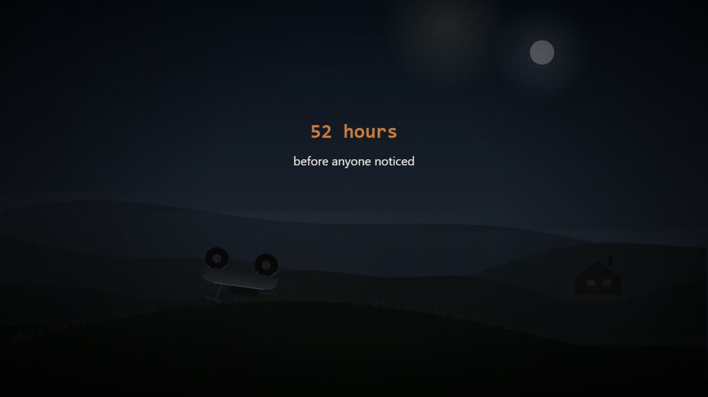
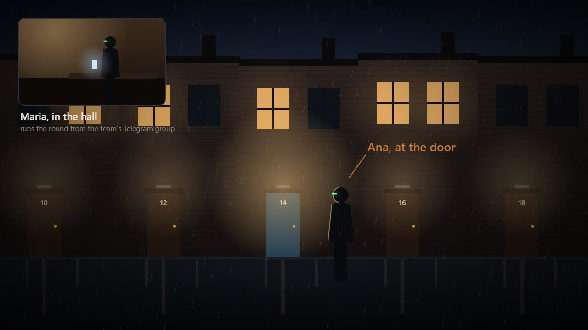
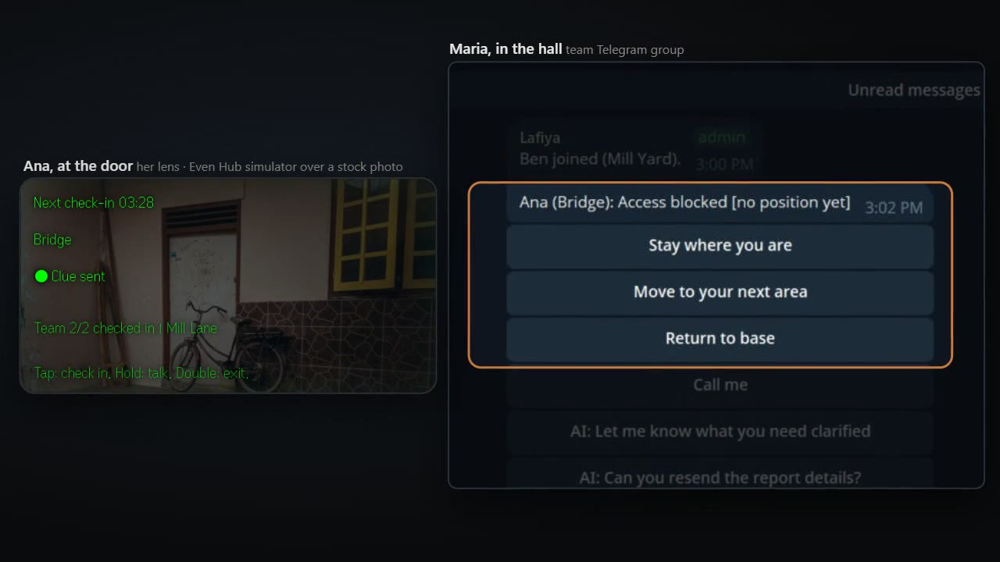
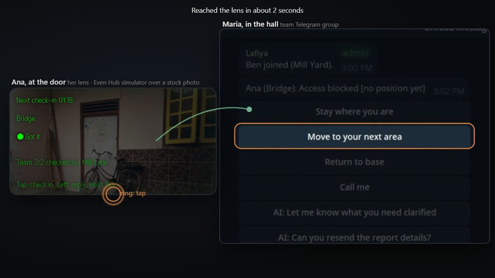
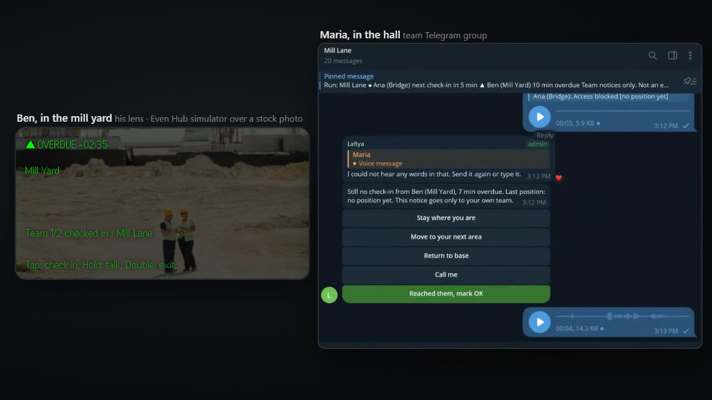
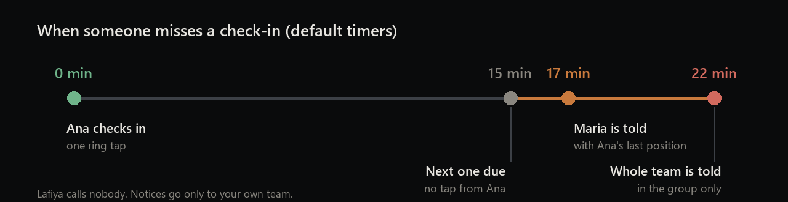
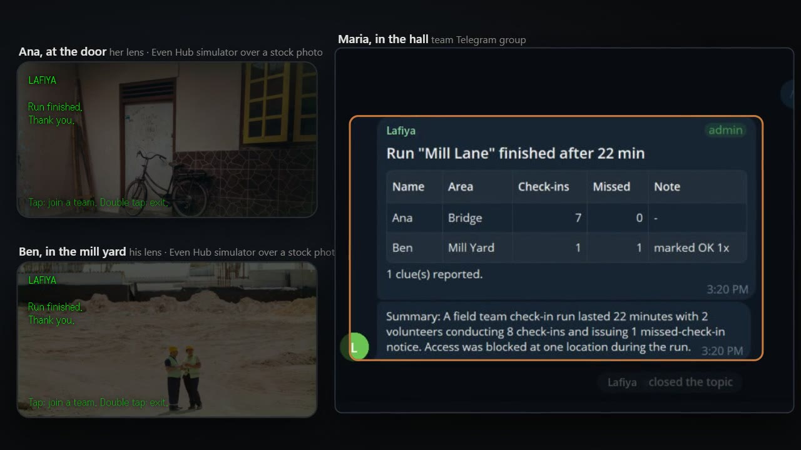
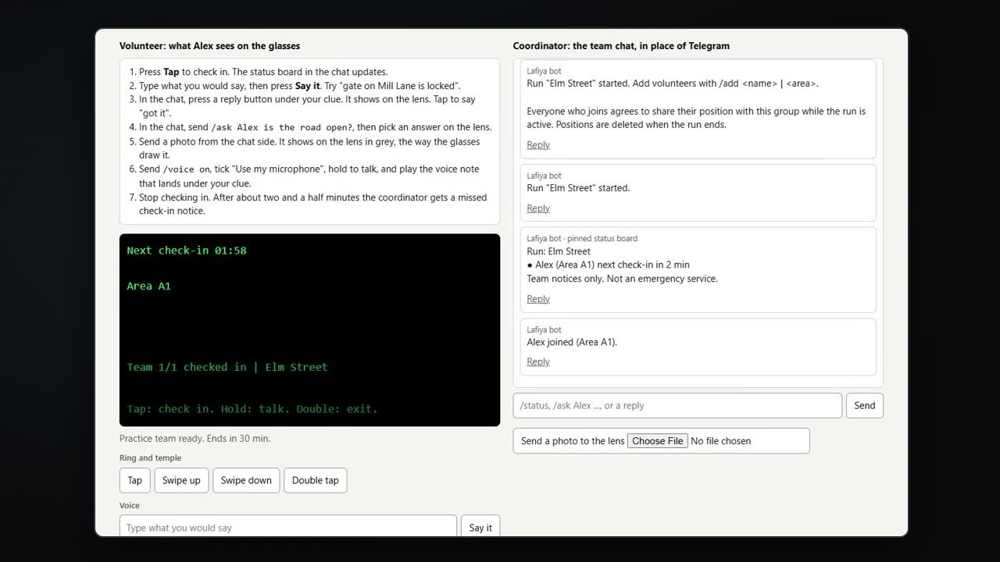

# Lafiya: team check-ins on Even G2 glasses, run from Telegram


*Lafiya* is how you ask "are you well?" in Hausa, which is the question every check-in asks.

**A check-in on Even G2 glasses, run from the team's Telegram group, so a coordinator knows in minutes when someone on a small field team goes quiet.**


*Ana's lens in the Even Hub simulator, shown over a stock photo of a doorway.*

| | |
|---|---|
| Try it, no glasses | https://callout-dih6.onrender.com/try (the lens and the team chat side by side, no sign-in) |
| Status page | https://callout-dih6.onrender.com/status (which parts are on, no names or positions) |
| Code | https://github.com/Sireadell/lafiya |

## Why I built it



October 2004, the Scottish Borders. A stand-in gamekeeper, working alone, was badly hurt when his quad bike rolled over. He had no way to raise the alarm or report in. Nobody noticed he was missing for 52 hours. He didn't survive.

The safety regulator's lesson was plain: people who work alone need a way of keeping in touch ([HSE case study](https://www.hse.gov.uk/agriculture/experience/lone-working-gamekeeper.htm)). That's what I built Lafiya for: small teams out on foot, like welfare-check rounds, charity drivers and flood wardens.

## One round, start to finish



Maria runs a volunteer round from the hall. Ana is at a door in the rain, hands full, phone in her pocket. Her lens shows when her next check-in is due, her area, and how many of the team have checked in. One tap and she's checked in. The pinned board in the group updates by itself.



The side gate is locked, so she picks a quick clue from the menu. It lands in the group as a map pin with reply buttons, plus two that AI drafts from her clue.



Maria taps "Move to your next area". **About two seconds later it's on Ana's lens.** That was seen on the live server with real Telegram, and it held for a typed line, a photo and a question's answer too. Ana taps once, and the group sees she got it. Maria can also send a photo of the right door, a voice message that Ana reads as words, or `/ask all Are you OK?`, and the pinned board counts the answers.



Then Ben misses a check-in:



Once Maria reaches him, one button marks him OK.



When Maria ends the run, the group gets a table: check-ins, missed ones, and any area nobody checked in from, with a short AI summary. No position is kept after the run.

It's built on the Even Hub SDK (text and image containers, ring and temple taps, the glasses microphone, motion and device status) and on Telegram's Bot API with a Mini App. A clue becomes a Telegram map pin about 0.65 seconds after it reaches the server (four clues, 626 to 687 ms).

## Check it in one minute



Open [/try](https://callout-dih6.onrender.com/try). You don't need glasses, a sign-in or an install. You get your own practice team for 30 minutes on the real lens app and bot, with the chat on the page instead of Telegram. It's a preview, not the glasses.

1. Press **Tap** to check in. The status board in the chat updates.
2. Type a clue, say "gate on Mill Lane is locked", and press **Say it**. It lands in the chat with reply buttons.
3. Press a reply button there. It shows on the lens. Tap again to say "got it".

The page lists more, up to a missed check-in notice after about two and a half minutes.

To check the code yourself, you need Node 22 or newer. No keys or accounts.

```powershell
git clone https://github.com/Sireadell/lafiya
cd lafiya
npm install
npm run proof
npm test
```

| Command | What it shows | Result today |
|---|---|---|
| `npm run proof` | A full run on a fake Telegram chat: pairing, clue pin, reply, notices at 17 and 22 minutes, battery, glasses off, gone quiet, debrief, clean-up | 23 of 23 checks pass, 36 messages sent |
| `npm test` | Server tests, with a fake clock so timers run in milliseconds | 189 of 189 pass |
| `cd glasses; npm install; npm test` | The lens app against fake glasses and a fake server | 66 of 66 pass |
| `npm ci --prefix glasses; npm run panel:proof` | The real lens app against a local server, with fake glasses input and a fake Telegram | All checks pass |

GitHub Actions runs all four on each push. The glasses app is a private beta on Even Hub (0.2.2) with 3 testers invited. Nobody has run it on real glasses yet.

The server uses one outside package, an MP3 encoder for voice notes. Everything else is plain Node.

## The judging lines

| Judging line | Where you see it |
|---|---|
| "Usefulness on G2 · 30%. Solves a real everyday moment, works at a glance and hands-free." | The check-in on a field shift. At a glance: countdown, area, team count. Hands-free: hold to talk, and a due check-in listens for "OK" |
| "Read and write · 25%. Acting is fast: a short phrase, one tap or the ring, with smart defaults or AI drafts instead of long dictation." | Read: the reply as one line, a photo from the coordinator, and questions with up to 3 one-tap answers. Write: one tap checks in, picks a quick clue or says "got it", or hold, speak, let go. The coordinator answers with a button, an AI suggestion, a reaction, a line, a photo or a voice message, to one person or everyone |
| "Technical execution · 20%. Works end to end, reliable, clean code." | End to end on the live server with real Telegram, and a try page that needs no glasses. 189 server tests, 66 lens tests, 23 proof checks. Timers live on the server, so a paused phone still gets noticed. With no signal, items wait and go out later |
| "UX for display and voice · 15%. Clear on a 576 × 288 monochrome display, natural by voice." | A bright main line, a dim status line and a dim hint, each with a line limit. Plain glyphs (● ○ ▲), since the lens drops emoji. Every gesture gets an answer on screen |
| "Business potential and safety · 10%. Real users and demand, careful with data and money." | Team notices only, not an emergency service. "I'm not OK" never checks in. Only the coordinator can act. No position kept after a run, keys only as hashes, the run notice says what goes to the AI. No real users yet, buyers are a guess |

## On the glasses

| Part of the Even Hub SDK | How Lafiya uses it |
|---|---|
| Startup page, three text containers | The three boxes, updated in place |
| Image container | The coordinator's photo, shrunk to 288 × 144 and greyed on the phone, caption above. Tap says "got it", swipe closes |
| Tap, double tap, swipe, long press, event source | Ring or right temple tap checks in, left temple repeats the reply. Hold to talk. Double tap exits. Swipe cancels |
| Menu and list container | Lens menu, quick clues, one-tap answers |
| Microphone audio | Hold to talk (up to 10 s), Clue by voice (4 s), the spoken "OK". With voice notes on, the clue's recording goes with it. Frames marked as another speaker are dropped (untested) |
| Motion sensor, device status | "Still there?" after about five minutes with no head movement. Battery, worn, in case, connection |
| App location, camera, album | Last known position on clues and check-ins. A photo on the last clue |
| Local storage, exit events | Sign-in key and the offline queue. Closing the app tells the coordinator |

Speech can mean a check-in, quick clue, backup (confirm screen only), cancel, or a clue. "Not", "no", "help", "hurt" never check in.

## Track 1 (Messaging and News) and Best Telegram

| Prize line on the event page | Where Lafiya answers it |
|---|---|
| Track 1 example: "Reply by voice, or approve a reply drafted by an AI agent" | Volunteers answer by voice (hold to talk) or with one tap. Under each clue the coordinator gets up to 2 AI-drafted replies to approve with one press (seen live, not yet pressed live) |
| Best Telegram: "the best use of Telegram (accounts, bots, channels or Mini Apps) on G2" | A bot, and a Mini App (on the live server, not yet opened inside Telegram). I left out user accounts, since acting as someone means reading their private chats |

| What it does | Telegram feature |
|---|---|
| Add-to-group link asking only the rights needed, naming any missing | `startgroup` with `admin=`, `my_chat_member`, `setMyCommands` |
| `/join 4821` with the lens code, then the coordinator picks the area | Inline keyboard |
| Refusals and group pairing codes shown to one person only, never safety notices | Ephemeral messages |
| One status board, pinned and edited in place | `pinChatMessage`, `editMessageText` |
| Clues and backup requests as map pins with reply buttons and AI suggestions. Mark OK green, Check in blue | `sendVenue`, inline keyboard, button `style` |
| Live location (stopped at the end), a topic per run, a photo under its clue | `editMessageLiveLocation`, `createForumTopic`, `sendPhoto` |
| A coordinator photo or voice message shows on the lens (voice as words) | `getFile`, speech to text |
| `/reply all` and `/ask all` reach every lens on the run, and the board counts the answers | `editMessageText` |
| `/voice on`: a spoken clue's recording under the clue, protected. Off by default | `sendVoice` |
| Check-ins quiet, missed ones buzz, positions can't be forwarded | `disable_notification`, `protect_content` |
| Reactions show on the lens (thumbs up is "Seen"), and the bot reacts once a reply is seen | `message_reaction`, `setMessageReaction` |
| Debrief as a table, with areas nobody checked in from | Rich message table, plain text fallback |
| Coordinator dashboard, positions as dots, no map service | Mini App, sign-in checked on the server |
| Only the setup person or an admin can act; one coordinator can run two teams | `getChatMember` |
| "Check-in time" in the volunteer's own chat, with a Check in button that works while the app is paused | Private chat |
| Stays under limits, webhook or polling | 3.1 s between group sends, retry on 429, `setWebhook` with a secret |

Discord is a second channel: webhook notices, and signed reply buttons that only listed coordinators can press.

## Track 4: the Sheet and AI

| Part | What it does |
|---|---|
| Sheet in and out | A Volunteers tab feeds `/import`. At `/end`, rows go to a Debrief tab (with the AI summary) and a Clues tab. No positions |
| AI one-line reply | A message over 60 characters becomes one lens line; the full text is under Repeat reply |
| AI suggestions | Up to 2 reply buttons under each clue (never on safety notices) and up to 3 answers for an open question |
| AI run summary | Three plain sentences posted at `/end` |

What goes to the AI service, only if a key is set (Claude or OpenRouter): clue words, coordinator replies over 60 characters, open questions, and the run length and counts for the summary. The server adds no names or positions, but words go as typed or said, so a name inside one goes too. Without a key, long replies are trimmed and answers come from word rules.

## How each claim is checked

"Live" below means my own runs with real Telegram, including full rounds on the live server from 25 to 27 November, with my own accounts and two Even Hub simulators. No real glasses and no other people. After the PC locked, the group saw "gone quiet for 3 minutes", then "back online".

| Claim | Shown by | Status |
|---|---|---|
| Clue becomes a protected map pin with reply buttons | [proof.js](server/proof.js), [bot.test.js](test/bot.test.js) | Tested, seen on real Telegram |
| Missed check-in: coordinator at 17 minutes, team at 22 | [engine.test.js](test/engine.test.js) | Tested, seen live with short timers |
| Only the setup person or an admin can run, end or reply | [review.test.js](test/review.test.js) | Tested, seen live from a second account, for `/end` and a reply button |
| Mark OK, private nudges, backup, eyes reaction, `/interval` | [review.test.js](test/review.test.js) | Tested, seen on real Telegram |
| No position kept after a run, keys and codes only as hashes | `npm run proof`, [engine.test.js](test/engine.test.js) | Tested. The live Sheet copy, read after a run: 0 coordinate-shaped numbers, no raw keys or codes |
| "I'm not OK", "no" and "help" never check in; backup never sent by voice alone | [voice.test.js](glasses/test/voice.test.js), [intent.test.js](test/intent.test.js) | Tested. Live by voice for "I am not OK" only (see below) |
| Hold to talk, three-box lens, quick clues per run, one-tap answers, 4 digit join | [glasses/test](glasses/test), [ask.test.js](test/ask.test.js), [join.test.js](test/join.test.js) | Tested. Live: Ben tapped "No" and it showed under the question in about 2 seconds |
| Replies pushed by a held request, `/status` timings | [longpoll.test.js](test/longpoll.test.js) | Tested. Live: a button press, a typed reply and a photo each reached the lens in about 2 seconds |
| `/reply all`, `/ask all` with a count on the board, voice message replies | [everyone.test.js](test/everyone.test.js), [stt.test.js](test/stt.test.js) | Tested. Live, once each: `/reply all` reached both lenses, the board read "Yes 1, No 1" after `/ask all Are you OK?`, 20 typed replies in a row all arrived, and a 3 second voice reply showed on Ana's lens as "Check the blue door first." |
| One-person messages, AI suggestions, button colours, table debrief, two teams, app-closed notice | [private.test.js](test/private.test.js), [drafts.test.js](test/drafts.test.js), [debrief.test.js](test/debrief.test.js), [closed.test.js](test/closed.test.js) | Tested. Live: a code shown "Only visible to you", and AI buttons. The rest fake Telegram only |
| Offline queue keeps its own time (30 minute cap, never the future) | [review.test.js](test/review.test.js), [offline.test.js](glasses/test/offline.test.js) | Tested: with the signal cut, two check-ins wait, the lens shows "2 waiting to send", and both go out once, oldest first. No real signal loss yet |
| `/end clear` | [review.test.js](test/review.test.js) | Fake Telegram only |
| No emergency, life-saving or health wording; AI suggestions with words like trapped or hurt are dropped | [engine.test.js](test/engine.test.js), [view.test.js](glasses/test/view.test.js), [ai.test.js](test/ai.test.js) | Tested |
| Sheet in and out, AI line and summary | [ai.test.js](test/ai.test.js) | Tested. Ran live with a real Sheet and a real `/end` |
| "Still there?", Discord buttons, Mini App | [motion.test.js](glasses/test/motion.test.js), [discord.test.js](test/discord.test.js), [miniapp.test.js](test/miniapp.test.js) | Tested with fakes only |
| Photo from the coordinator on the lens | [picture.test.js](test/picture.test.js), [picture.test.js](glasses/test/picture.test.js) | Tested. Sent from real Telegram as a reply to a clue and drawn in the simulator |
| Voice notes, off until `/voice on`, never stored | [voicenote.test.js](test/voicenote.test.js), [voicenote.test.js](glasses/test/voicenote.test.js) | Tested. Arrived in real Telegram under the clue, played back, and removed by `/end clear`. Off, no recording went out |
| `/try` practice teams: separate, 30 minutes, capped, no Telegram, Sheet, AI or disk | [sandbox.test.js](test/sandbox.test.js) | Tested, and run in a browser at desktop and phone width |

## Bugs the live test found

All seven are fixed and tested: the board posted three times at once; turning on Topics made the bot lose its team; an empty field went as "undefined" and a photo failed; about 1 send in 8 was lost to dropped connections (now retried once); `/import` listed someone twice; the AI summary said "10-minute" for 9; and the simulator's exit after a menu pick read as the app closing (now ignored).

## Not yet checked live, and known gaps

| Part | Where it stands |
|---|---|
| Voice on the lens | Simulator and PC microphone, phrases played by the computer's voice. "The bridge on Mill Lane is flooded" came back word for word. "I am OK" checked in, "I am not OK" didn't. 5 recorded phrases came back right in 3 to 4 s, and "I don't need backup" stayed a clue. One phrase was misheard once and posted as a free clue. Not tried: a human voice on the lens, the glasses mic |
| App closed | The simulator only sends an exit right after a menu pick, which Lafiya ignores. Fake glasses only. Unknown whether the notice leaves a real phone |
| Discord | A webhook notice reached a real channel in 1 second. Reply buttons with fakes only |
| AI | Ran for real through OpenRouter (Claude Haiku): one line in 2.1 s, a summary in 2.6 s, AI buttons under a live clue (never pressed). Answer choices not yet |
| Mini App | On the live server. Not opened inside Telegram yet |
| Real G2 glasses | Simulator only. Camera, album, left temple tap and "Still there?" are untested, since the simulator sends no photos or motion |
| Not built | An arrow to your area, a trail map |
| Gaps not fixed yet | Without a linked coordinator chat, a pairing code can land in the group (with a warning), and the first to open a `?start=` link becomes that volunteer's chat (the group is told who). A first private `/start` shows volunteers the coordinator commands |

## What this is not

- Not a life-saving tool, not an emergency service, and no replacement for radios or calling 999 or 911.
- No route finding, nothing medical. "Still there?" only asks.
- Positions only go to your team's chat (Telegram, and Discord if set up), never to the AI.
- "Ask team for backup" is a team message. It calls nobody.
- Nothing listens in the background. The mic opens while you hold to talk or pick Clue by voice, and for three short rounds when a check-in is due or on "Still there?".
- No camera on the glasses. Photos come from the phone.

## Privacy and consent

At `/run`, everyone who joins agrees to share their position with the group during the run, and is told what goes to the AI if it is on. During a run the server holds each volunteer's latest position and recent trail. At `/end` it clears those and every clue's position, stops live locations, and deletes the run's keys and codes. Its notice log writes any coordinate as "[position]".

Pins and notices with coordinates stay in the group, protected from forwarding, unless the coordinator sends `/end clear`. The Mini App shows positions as dots to the coordinator during a run only.

Sign-in keys and pairing codes are only stored as one-way hashes. If your host wipes its disk on restart, `STATE_SHEET_ID` keeps a private copy of the state in your own Google Sheet. It never has a position, but it holds names, areas and Telegram chat ids, so keep it private.

With a speech to text key, the provider deletes the transcript once the words come back. Voice messages and photos go to the group as sent, and with `/voice on` a spoken clue's recording does too (the group is told, and the confirm screen says so). The server never saves photos or recordings. A photo sent to a lens is held in memory for 15 minutes at most. Pairing codes work once and expire after 15 minutes, join codes after 10.

## Who would pay (not validated)

A guess: I haven't asked a buyer or tested a price. I'd start with groups that already run weekly volunteer shifts from a group chat (welfare-check rounds, charity delivery drivers, flood warden schemes), paying per team. Every volunteer would need G2 glasses.

## Run it with your own bot

1. Get a bot token from @BotFather. In `callout`, run `Copy-Item .env.example .env` and put the token in `.env`.
2. Run `npm install`, then `npm start`. The log says "Telegram: polling".
3. Send `/start` to your bot and use its link to add it to a group as admin.
4. In the group: `/team Test`, `/run Elm Street`, `/add Ana | Area A1`. A pairing code appears.
5. In a second window: `cd lafiya\glasses; npm install; npm run dev`. Open the page in the Even Hub simulator and enter the code. `npm run panel` fakes battery, signal and glasses off.
6. Tap to check in, pick a quick clue, watch the pin land, then send `/end`.

Other `.env` keys are optional; each turns on one part.

## What existed before 23 November

Nothing in this repo. I started it on 24 November for this hackathon. The Telegram alert and speech to text approach comes from two of my earlier projects.

